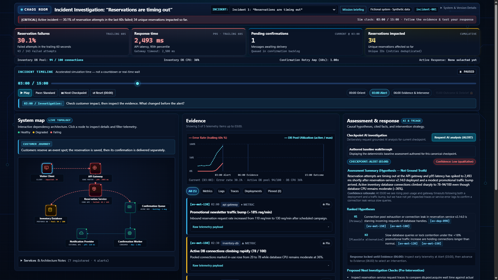

# Chaos Room | AI Incident Investigation Simulator

In the first incident, 43 of 143 reservation attempts failed in the past simulated minute. A new release just went out, and a promotion brought in more traffic. Which clue would you follow first?

Chaos Room puts you on call for a fictional event-reservation platform. Trace the customer impact across seven services, choose a response, and replay the incident to see how another choice would have played out. Each of the three incidents takes about 3–5 minutes. All telemetry is synthetic.

**[Launch the simulator](https://chaos.mikerestrepo.com/)** · [Read the product case study](https://mikerestrepo.com/projects/chaos-room/)



## Try the first incident

Open **Reservations are timing out** and use **Next Checkpoint** to move through 15 simulated minutes at your own pace. The optional guided tour introduces the console.

| Simulated time | Your decision |
| --- | --- |
| **00:00 · Orient** | Follow a reservation from the customer through booking and confirmation. Where would a customer notice a failure? |
| **03:00 · Alert** | Inspect the failure rate, latency, and deployment events. Pin the evidence that supports your first hypothesis. |
| **06:00 · Evidence & Intervene** | Choose one of three responses, including observing without making a change. The clock pauses here until you decide. |
| **15:00 · Outcome & Debrief** | See what happened to customers, compare the other responses, and check your reasoning against the root cause. |

The other two incidents start with successful bookings and missing confirmations. Similar customer reports can have different causes.

## Product and architecture decisions

- **Make responses comparable.** The React console and the backend use the same seeded TypeScript engine. With the scenario, engine version, and seed held fixed, you can replay the same moment, change one response, and see its effect on customers.
- **Give the investigator the last word.** On request, Gemini analyzes a checkpoint reconstructed on the server. The model sees the service map and the evidence available at that point. The server checks each cited evidence ID before showing the analysis. The visitor chooses the intervention.
- **Keep the exercise available on a public budget.** Every checkpoint with an assessment has an authored walkthrough. Validated AI results can be reused across visitors. Firestore reserves budget before a new model call, with a $4.50 monthly allowance for model generation.

## Explore the implementation

| Area | What to inspect |
| --- | --- |
| [React and Vite console](apps/web) | The service map, synchronized timeline, evidence filters, and decision gate. |
| [Shared simulation engine](packages/shared) | Scenario definitions, seeded replay, and the measures used to report customer impact. |
| [Firebase Cloud Functions](functions) | Checkpoint reconstruction, Gemini response validation, and Firestore accounting. |

[Architecture](docs/architecture.md) · [AI evidence and cache contract](docs/ai-contract.md) · [Operations runbook](docs/operations-runbook.md) · [Scenario authoring guide](docs/scenario-authoring.md)

## Run locally

Use Node.js 22 or later. The default development server uses a local mock for AI analysis and runs without Firebase credentials.

```sh
git clone https://github.com/mike-restrepo/chaos-room-simulator.git
cd chaos-room-simulator
npm ci
npm run dev
```

Open [localhost:5173](http://localhost:5173). Run `npm run typecheck`, `npm test`, and `npm run build` to check the workspaces. The separate Firestore integration suite runs with `npm run test:emulator` and requires Java 21 or later.

## Project ownership

Mike Restrepo defined the incident scenarios, customer-impact measures, intervention tradeoffs, and release acceptance criteria. He used Google Antigravity for AI-assisted implementation and reviewed the simulator against those criteria.
